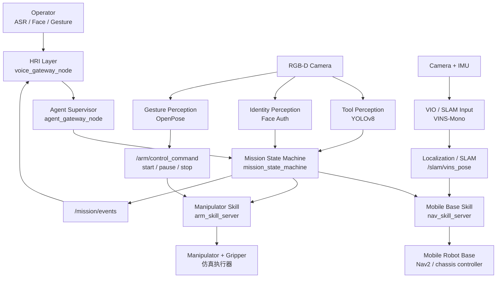
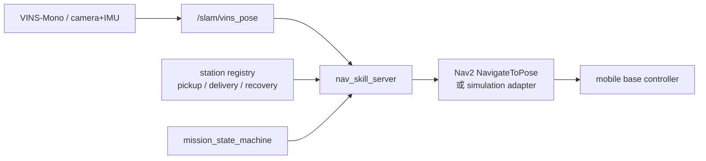
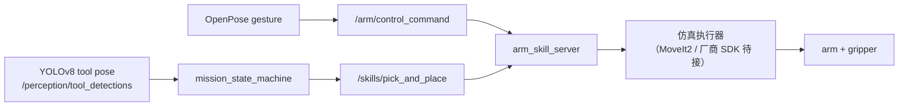
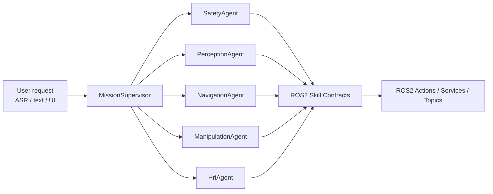
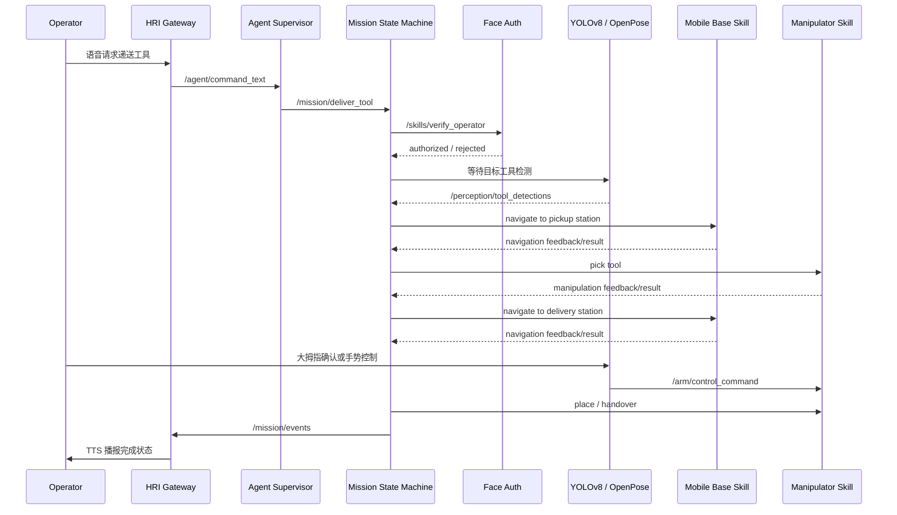

<div align="center">

# ROS2 Multimodal Robot Collaboration

**Agent Supervisor + Mobile Base + Manipulator + Multimodal Perception**


[](https://github.com/terrense/ros2-multimodal-robot-collab/actions/workflows/ci.yml)
[](https://github.com/terrense/ros2-multimodal-robot-collab/actions/workflows/docker.yml)

面向实验室/工业工作站场景的多模态机器人协作与工具递送系统。把移动小车、机械臂、相机、YOLOv8、OpenPose、人脸识别、VINS-Mono、Nav2、ASR/TTS 和任务级 Agent 调度统一到 ROS 2 分布式框架中，实现「识别工具 → 移动取物 → 机械臂抓取 → 递送给操作者」的闭环。

</div>

> **当前全部运行在 Gazebo 仿真上，没有真机验证。** 机械臂执行、人脸识别、语音、手势都是仿真或桩节点；YOLOv8 默认用桩，可切真推理。所有「实测」字样都指仿真或 CPU 上的可复现测量，不指物理机器人。

## 目录

- [快速开始](#快速开始) · [仿真车间](#仿真车间workshop)
- [项目状态](#项目状态) · [**全项目现状与卡点**](docs/status.md) · [三条工作线](#三条工作线)
- [总体架构](#总体架构) · [分层职责](#分层职责)
- [移动小车](#移动小车负责什么) · [机械臂](#机械臂负责什么) · [感知](#感知系统怎么配合) · [Agent](#agent-和-multi-agent-设计)
- [完整任务流程](#完整任务怎么跑) · [ROS 2 接口速查](#ros2-接口速查)
- [工程结构](#工程结构) · [测试](#测试)
- [后训练](#后训练从规则恢复到可训练策略) · [L1↔L2 校准](#l1l2-校准)
- [第三方源码](#third-party-source) · [Roadmap](#roadmap) · [License](#license)

---

## 快速开始

目标：在 Windows + WSL2 里构建项目，在 Gazebo 看见小车，用 ROS 2 命令让它动起来。

**环境**：Windows 11 + WSL2、Ubuntu 22.04、ROS 2 Humble、Gazebo Classic 11、Nav2、Python 3.10、colcon、rosdep。

### 1. 安装依赖（一次）

```bash
wsl -d Ubuntu-22.04
```

```bash
sudo apt update
sudo apt install -y software-properties-common curl gnupg lsb-release
sudo add-apt-repository universe

sudo curl -sSL https://raw.githubusercontent.com/ros/rosdistro/master/ros.key \
  -o /usr/share/keyrings/ros-archive-keyring.gpg

echo "deb [arch=$(dpkg --print-architecture) signed-by=/usr/share/keyrings/ros-archive-keyring.gpg] \
http://packages.ros.org/ros2/ubuntu $(. /etc/os-release && echo $UBUNTU_CODENAME) main" | \
sudo tee /etc/apt/sources.list.d/ros2.list > /dev/null

sudo apt update
sudo apt install -y \
  ros-humble-desktop \
  ros-humble-navigation2 ros-humble-nav2-bringup \
  ros-humble-gazebo-ros-pkgs ros-humble-slam-toolbox \
  ros-humble-robot-localization ros-humble-rmw-cyclonedds-cpp \
  python3-colcon-common-extensions python3-rosdep python3-vcstool python3-pip

sudo rosdep init || true   # 只需一次
rosdep update
echo "source /opt/ros/humble/setup.bash" >> ~/.bashrc
```

> **`ros-humble-rmw-cyclonedds-cpp` 不是可选的。** WSL2 的 `networkingMode=mirrored`
> 会让 Fast DDS 跨进程丢 Topic 数据（发现和服务还能用）。仓库的所有脚本都默认
> `RMW_IMPLEMENTATION=rmw_cyclonedds_cpp`，缺这个包会看到节点都在、话题却没数据。

### 2. 构建

```bash
cd <你的克隆路径>/ros2-multimodal-robot-collab-main

bash scripts/check_ros2_env.sh        # 检查 ROS2 / Gazebo / Nav2
bash scripts/build_ros2_workspace.sh # 只构建 src/
```

`third_party/` 里是 vendored 源码快照（VINS-Mono / OpenPose / Ultralytics），**不要**让 colcon 编译它们。

> 建在 `/mnt/d` 或 `/mnt/f` 上很方便但更慢。重度使用 Gazebo/Nav2 时把仓库拷进 WSL 的
> ext4 文件系统（`~/work/`）会明显更快。

### 3. 看见机器人并让它动

开三个 WSL 终端，都要先 `cd` 到仓库根目录。

**终端 A** — 起 Gazebo + 节点栈：

```bash
bash scripts/run_gazebo_visible_demo.sh
```

**终端 B** — 让小车动起来：

```bash
bash scripts/send_motion_test.sh 5
```

**终端 C** — 干跑一份 Agent 计划（不派发）：

```bash
bash scripts/run_agent_plan_dry_run.sh
```

终端 A 仍在运行时，把计划真正打到活的 ROS 2 图上：

```bash
bash scripts/execute_agent_plan.sh
```

收工：

```bash
bash scripts/stop_gazebo_demo.sh
```

### 4. 接入真实 Nav2

```bash
# 等价于 start_slam:=true start_nav2:=true nav_backend:=nav2
FULL_NAV=1 bash scripts/run_gazebo_visible_demo.sh
```

另开一个终端：

```bash
source /opt/ros/humble/setup.bash && source install/setup.bash
ros2 action send_goal /skills/navigate_to_station \
  robot_collab_interfaces/action/NavigateToStation \
  "{station_id: 'station_a', reason: 'visible Nav2 test'}" --feedback
```

站点坐标来自 `src/robot_collab_bringup/config/stations.yaml`，不在上层写死底盘坐标。

### 5. 真实 YOLOv8（可选）

默认工具检测是写死的桩节点（`tool_detector_node`），保证离线可跑。切真推理：

```bash
pip install ultralytics
python3 -c "from ultralytics import YOLO; YOLO('yolov8n.pt')" && mv yolov8n.pt models/

FULL_NAV=1 bash scripts/run_gazebo_visible_demo.sh use_yolo:=true
ros2 topic echo /perception/tool_detections      # 应看到真实 label/confidence
python3 scripts/snapshot_camera.py               # 确认相机里有目标物
```

COCO 预训练权重认不出项目工具，所以 `demo_params.yaml` 把若干常见 COCO 类
（bottle / cup / cell phone…）映射到请求的 `tool_id`。在机器人相机前放一个这类物体，
`/perception/tool_detections` 就会出真实检测、放行任务。

### 6. 用 LLM 做规划（可选）

```bash
cp .env.example .env       # 填入 MINIMAX_API_KEY，.env 不进 git
python3 agent_harness/scripts/minimax_mission_planner.py \
  "deliver the 3mm hex key to station_a for operator_001" \
  --output agent_harness/generated/last_plan.json --dry-run
```

### 排错

| 现象 | 原因 | 处理 |
|---|---|---|
| Gazebo 起不来，报 `Failed to initialize scene` | 覆盖了 `GAZEBO_RESOURCE_PATH`，把 Gazebo 自带的 Ogre media 藏了 | **不要**覆盖它；只要 `GAZEBO_MODEL_PATH`（`scripts/setup_gazebo_models.sh` 会建） |
| `spawn_entity` 服务不存在 | `GAZEBO_MODEL_PATH` 指向 `/opt/ros/humble/share`，Gazebo 在扫几千个目录 | 用 `setup_gazebo_models.sh` 生成的精简目录 |
| 节点都在，话题没数据 | Fast DDS 在 WSL mirrored 网络下失效 | `export RMW_IMPLEMENTATION=rmw_cyclonedds_cpp` |
| 机械臂在 Gazebo 里看不见 | MoveIt 的 URDF 缺 `<inertial>`，URDF→SDF 静默丢 link | `scripts/ensure_urdf_inertials.py` |
| 机械臂翻倒 | 动态模型没有 controller | `scripts/make_static_sdf.py`（`<static>true</static>`） |
| 窗口渲染异常 | WSLg 的 GL | `SOFTWARE_RENDERING=1 bash scripts/run_gazebo_visible_demo.sh` |
| `$'\r': command not found` | Windows CRLF | `git config core.autocrlf` / 转 LF |

完整的 15 条踩坑记录：[`docs/openrua_audit/gazebo-failure-log.md`](docs/openrua_audit/gazebo-failure-log.md)。

---

## 仿真车间（`--workshop`）

除默认的 lab 场景外，还有一个更接近真实工作站的车间：

```bash
bash scripts/run_gazebo_demo.sh --workshop        # 车间 + 官方机械臂模型
bash scripts/run_gazebo_demo.sh --workshop --nav2 # 再加 SLAM + Nav2
```

| 组成 | 内容 |
|---|---|
| 机械臂 | KUKA KR10（橙黑）、FANUC M-10iA（绿）、车载 Dobot CR10（白 + 深蓝）——都是官方 URDF，不是自绘盒子 |
| 本体 | Dobot 装在加宽加重的移动底盘上（0.80×0.62×0.22 m，30 kg，轮距 0.72 m），不会翻 |
| 场景 | 四面墙 + 门洞、黑白格墙 + `laboratory` / `factory` 渐变字标、大型棋盘标定板、棕色/米黄两张工作台、全局相机 |
| 传感器 | RealSense D435（RGB-D）与 Velodyne VLP-16，均为官方 description |

场景由脚本生成，不手改 world 文件：`scripts/generate_workshop_world.py`（几何）+
`scripts/generate_workshop_textures.py`（贴图）。

---

## 项目状态

**2026-11-11** · 主套件 455 passed / 3 skipped，harness 套件 59 passed（另 3 个 ROS 测试在 CI 的 ROS 容器里跑），CI 与 Container 全绿。

| 模块 | 已实现 | 验证到什么程度 |
|---|---|---|
| **CI/CD** | lint · pytest · harness pytest · ROS 2 容器构建 · GHCR 镜像 | CI 全绿 |
| **契约 v1.2** | 命令身份、执行状态（含 `unknown`）、回执、快照新鲜度、能力注册表 | 单测 |
| **工具运行时** | 每资源 FIFO、只撤销排队、SQLite 账本、失败关闭、按资源加锁 | 15 项故障注入（进程内） |
| **Agent 闭环** | observe → 决定**一个**动作 → 校验 → 提交 → 等回执；轮数/字符/墙钟预算 | 单测 |
| **观测快照** | D435 快照 + `map→camera_link` + 评估字段隔离 | 仿真 |
| **仿真车间** | 见上节 | Gazebo 实测 |
| **传感器** | D435（RGB-D）、VLP-16、16 线激光、2D 雷达、IMU | 话题实测 |
| **导航** | Nav2 `NavigateToPose` 打通；SLAM 用 odometry 建图 | 仿真实测（scan matching 已关闭，见下） |
| **L2 适配器** | 实时栈装进 L1 的 `reset()/step()`；动作映射写全，不支持的动作带原因拒绝；同一套评测给实时栈打分并产出回执指标 | **逻辑已测，ROS 路径未跑** |
| **并发调度** | 每资源一把锁 + `MultiThreadedExecutor` + 每资源 callback group（`--concurrent`） | **rclpy 层已验（CI 里跑），全栈未跑** |
| **线缆故障注入** | 判据先写（`docs/specs/wire-faults.md`，11 条：安全/活性/设置）+ `tc netem` 五套场景 + 按判据判定 | **已构建，未运行**（netem 免 sudo 已验证） |
| **L1↔L2 校准** | 九类故障的 L1 参考值（从配置推导）、每族测量方案、执行器、清单写入 | **2/9 已测，两个都推翻了 L1**：`identity_mismatch` 实测 0%（L1 说 34.6%）、`nav_timeout` 实测 100%（L1 说 66.5%） |
| **实验基线** | 规则基线 76.1% / 脚本专家 100%（400 条故障注入 benchmark） | **CPU 可复现**，产物入库 |
| **后训练栈** | SFT / DPO / Step-Level PPO / OPD + 显存预检 + teacher 独立服务 | **未上 GPU**，六条臂 pending |

**已知限制**（都在文档里写明了，不是待办清单）：

- **SLAM scan matching 关闭。** 用 odometry 建图，没有回环和漂移校正。调参实验做到 84% 跟踪率仍会导航失败，所以关掉直到能用同样方法验证。
- **机械臂执行是仿真的。** `arm_skill_server` 用 `simulate_step_seconds` 模拟动作，没有接 MoveIt2 或厂商 SDK。
- **人脸 / 语音 / 手势是桩或用 vendored 源码跑，没有真机。**
- **六条模型实验臂没跑过。** `docs/results.md` 里 pending 的行就是它们。

> 上表是模块清单。**哪条线卡在哪、下一步该动什么**，见
> [`docs/status.md`](docs/status.md) —— 全项目现状页。一句话版本：
> **机器人和运行时都通了，但一个模型都还没训**，因为那要 GPU。

---

## 三条工作线

仓库里有三条并行的工作线，各自都用过 "Phase N"。**前缀是它们的区别**：

| 前缀 | 线 | 目录 | 干什么 |
|---|---|---|---|
| **R** | 机器人本体 | `src/robot_collab_*` | 传感器、机械臂、导航、仿真、真机 |
| **PT** | 后训练 | `agent_env/` + `training/` | L1 仿真环境、奖励、信用分配、SFT/DPO/PPO/OPD |
| **O** | OpenRUA 吸收 | `agent_harness/` | 吸收 `Open-RUA/uni-robot-agent` 的工程纪律：契约、可靠运行时、执行证据 |

**OpenRUA 上游没有任何训练代码** —— 它是 agent 编排框架，不是 RL 框架。它的 Phase 7
叫「训练集成」，意思是**让已有的训练产出可被信任的数字**，不是「开始训练」。

完整地图：[`docs/specs/README.md`](docs/specs/README.md)（每阶段产出了什么、还剩什么）
和 [`docs/roadmap.md`](docs/roadmap.md)（三条线的总览）。

---

## 总体架构



系统不是让一个节点直接控制所有硬件，而是按职责拆开：Agent 只做任务决策和技能选择；
状态机负责可靠执行；移动小车和机械臂各自有独立的 Action Server；感知模块通过
Topic/Action 把事实发布给执行层。替换真实底盘、机械臂 SDK、摄像头或规划器时，
不需要推倒整个系统。

## 分层职责

| 层级 | 负责什么 | 对应模块 | 关键 ROS 2 接口 |
| --- | --- | --- | --- |
| Agent 总控层 | 解析任务、选择技能、做安全/权限判断、决定是否重试或中止 | `robot_collab_agent`, `agent_harness`, `skills` | `/agent/command_text`, `/system/query_state`, `/mission/deliver_tool` |
| 任务编排层 | 串联完整流程，管理状态、反馈、异常回退 | `robot_collab_core` | `/mission/deliver_tool`, `/mission/events` |
| 移动小车层 | 定位、导航、到达工具区和工作站 | `robot_collab_navigation`, `robot_collab_slam` | `/skills/navigate_to_station`, `/slam/vins_pose` |
| 机械臂层 | 抓取、抬升、转移、放置、递送确认、暂停/恢复/急停 | `robot_collab_manipulation` | `/skills/pick_and_place`, `/arm/control_command` |
| 感知层 | 工具检测、操作者身份验证、手势识别 | `robot_collab_perception` | `/perception/tool_detections`, `/skills/verify_operator`, `/hri/gesture_command` |
| 人机交互层 | ASR 输入、TTS 播报、任务状态反馈 | `robot_collab_hri` | `/hri/asr_text`, `/hri/tts_text`, `/mission/events` |
| 接口层 | 统一 Action/Service/Message 定义 | `robot_collab_interfaces` | `DeliverTool`, `NavigateToStation`, `PickAndPlace`, `VerifyOperator` |
| 仿真层 | Gazebo world、官方机器人模型、传感器 description | `robot_collab_sim` | `workshop.world`, `collab_mobile_base.urdf.xacro` |
| Bringup 层 | 启动文件、参数、站点配置 | `robot_collab_bringup` | `demo_sim.launch.py`, `gazebo_nav_vins_demo.launch.py` |

## 移动小车负责什么

移动小车子系统只关心「机器人底盘如何可靠到达某个站点」，不负责机械臂怎么抓，也不负责理解用户意图。



| 模块 | 职责 |
| --- | --- |
| `vins_mono_bridge_node` | 接入 VINS-Mono 或 ros1_bridge 输出的视觉惯性里程计，发布 `/slam/vins_pose`。仿真阶段由 Gazebo `/odom` 顶替。 |
| `nav_skill_server` | 对上暴露 `/skills/navigate_to_station` Action，把「去 station_a」转成 Nav2 目标。`backend:=simulated`（默认）或 `nav2`。 |
| Nav2 / SLAM | 地图、定位、路径规划、避障、底盘控制。**Scan matching 已关闭**，用 odometry 建图。 |
| station config | `src/robot_collab_bringup/config/stations.yaml` 管理命名位置，上层不写底盘坐标。 |

完整任务里执行两段导航：先去工具存放区/工作台，抓取完成后去目标操作者工作站。

## 机械臂负责什么

机械臂子系统只关心「如何安全地抓取、移动、递送工具」，不负责底盘去哪，也不负责判断请求是否合法。



| 模块 | 职责 |
| --- | --- |
| `arm_skill_server` | 对上暴露 `/skills/pick_and_place` Action；**当前是仿真执行器**（`simulate_step_seconds`），按阶段发 feedback。 |
| `/arm/control_command` | 接收手势转来的控制命令，开始 / 暂停 / 急停。 |
| MoveIt2 / 厂商 SDK adapter | **尚未接入**。接入点就是 `arm_skill_server` 内部那段仿真执行。 |
| TF / calibration | 相机、底盘、机械臂基座、末端执行器之间的变换。真机部署前必须标定。 |

手势控制直接影响机械臂安全状态：

| 手势 | 识别结果 | 机械臂命令 | 行为 |
| --- | --- | --- | --- |
| 握拳 | `fist` | `arm_pause` | 暂停动作，保留任务上下文 |
| 张开手掌 | `palm` | `system_stop` | 停止当前任务，进入安全状态 |
| 竖起大拇指 | `thumb_up` | `arm_start` | 启动或恢复 |

> **安全边界**：这里的 stop 是「软件层的运动停止请求」，不是硬件急停。急停是
> controller / 硬件层面的职责，任何 LLM 或上层 Agent 都不能替代它，也不能放宽安全
> 边界。契约里的 `system_stop` 也只被当作请求记录，没有宣称是 E-stop。

## 感知系统怎么配合

感知模块不直接「控制机器人」，而是把环境事实发布给 Agent 和 Mission。

| 感知能力 | 节点 | 输入 | 输出 | 被谁使用 |
| --- | --- | --- | --- | --- |
| 工具检测 | `tool_detector_node`（桩）/ `yolov8_tool_detector_node`（真） | RGB/RGB-D 图像 | `/perception/tool_detections` | Mission、抓取流程 |
| 人脸验证 | `face_auth_node` | operator id / 人脸特征 | `/skills/verify_operator` Action result | Mission、Agent 安全策略 |
| 手势识别 | `gesture_recognizer_node` / `openpose_gesture_node` | 相机图像 | `/hri/gesture_command`, `/arm/control_command` | HRI、机械臂 |
| VIO 定位 | `vins_mono_bridge_node` | VINS-Mono odometry（仿真期用 `/odom`） | `/slam/vins_pose` | 导航链路 |

## Agent 和 Multi-Agent 设计

当前工程把 Agent 落在 `agent_gateway_node`（一次性任务规划）和 `agent_harness/`（闭环运行时）
中。后续可以拆成多个 Agent，但每个 Agent 只通过 ROS 2 skills 调用能力，不直接碰硬件。



| Agent | 关注点 | 调用的 ROS 2 能力 |
| --- | --- | --- |
| `MissionSupervisor` | 拆解任务、排序步骤、决定继续/重试/中止 | `/mission/deliver_tool`, `/system/query_state` |
| `SafetyAgent` | 身份、手势、安全状态、急停策略 | `/skills/verify_operator`, `/arm/control_command` |
| `PerceptionAgent` | 工具、操作者、手势等感知结果解释 | `/perception/tool_detections`, `/hri/gesture_command` |
| `NavigationAgent` | 选择目标站点、恢复点、导航策略 | `/skills/navigate_to_station`, `/slam/vins_pose` |
| `ManipulationAgent` | 选择抓取/放置策略、处理夹爪状态 | `/skills/pick_and_place`, `/arm/control_command` |
| `HriAgent` | 任务确认、状态播报、澄清问题 | `/hri/asr_text`, `/hri/tts_text`, `/mission/events` |

`agent_harness/` 里已经有实现的是**闭环**那一半（O5）：`observe → decide 一个动作 →
校验 → 提交 → 等回执 → 再 observe`，带轮数/字符/墙钟预算。上面这张多 Agent 分解图
是设计意图，不是现状。

## 完整任务怎么跑



异常回退：

- **人脸验证失败**：Mission 拒绝任务，HRI 播报无权限。
- **工具检测失败**：Mission 请求重新检测或进入人工确认。
- **导航失败**：重试导航或进入恢复点。
- **抓取失败**：重新规划抓取，重试耗尽后终止。
- **检测到张开手掌**：立即发布 `system_stop`，机械臂与状态机进入安全状态。

这些规则覆盖的是**预期内**的异常组合。没写规则的情况（组合故障、转运掉件、
操作者离岗）正是后训练要学的部分，见 [后训练](#后训练从规则恢复到可训练策略)。

## ROS 2 接口速查

| 类型 | 名称 | 谁提供 | 谁调用/订阅 |
| --- | --- | --- | --- |
| Action | `/mission/deliver_tool` | `mission_state_machine` | `agent_gateway_node`, external planner |
| Action | `/skills/verify_operator` | `face_auth_node` | `mission_state_machine`, SafetyAgent |
| Action | `/skills/navigate_to_station` | `nav_skill_server` | `mission_state_machine`, NavigationAgent |
| Action | `/skills/pick_and_place` | `arm_skill_server` | `mission_state_machine`, ManipulationAgent |
| Service | `/system/query_state` | `mission_state_machine` | Agent harness, 监控工具 |
| Topic | `/perception/tool_detections` | `tool_detector_node` / `yolov8_tool_detector_node` | `mission_state_machine`, PerceptionAgent |
| Topic | `/hri/asr_text` | ASR adapter / 操作台 | `voice_gateway_node` |
| Topic | `/agent/command_text` | `voice_gateway_node` | `agent_gateway_node` |
| Topic | `/hri/tts_text` | `voice_gateway_node`, `agent_gateway_node` | TTS adapter |
| Topic | `/hri/gesture_command` | `gesture_recognizer_node` / `openpose_gesture_node` | HRI, Agent |
| Topic | `/arm/control_command` | 手势节点 | `arm_skill_server` |
| Topic | `/slam/vins_pose` | `vins_mono_bridge_node` | 定位链路 |
| Topic | `/mission/events` | `mission_state_machine` | HRI, 监控, Agent |

---

## 工程结构

```text
src/
  robot_collab_interfaces/    # msg / srv / action 定义
  robot_collab_core/          # mission state machine
  robot_collab_agent/         # Agent Gateway: intent -> ROS 2 actions
  robot_collab_navigation/    # 站点导航 adapter（simulated / nav2）
  robot_collab_manipulation/  # 机械臂 action server（仿真执行器）
  robot_collab_perception/    # YOLOv8 / OpenPose / 人脸 / 工具检测
  robot_collab_slam/          # VINS-Mono bridge
  robot_collab_hri/           # ASR/TTS/手势网关
  robot_collab_sim/           # Gazebo world / 官方机器人模型 / 传感器 / 校准场景道具
  robot_collab_bringup/       # launch 文件与共享配置（含 stations.yaml）

agent_harness/                # 运行时：契约 / 每资源调度 / 账本 / Agent 闭环
  contracts/                  #   ActionRequest, ExecutionReceipt, 能力注册表, 单位与坐标系
  runtime/                    #   调度器, ToolClient, SQLite 账本, ROS 后端, 快照
  runtime/concurrency.py      #   每资源锁 + 不 spin 的等待（O3.1）
  runtime/wire_faults.py      #   netem 规则 + 线缆故障下的三条不变量
  agent/                      #   ClosedLoop, 预算, Scripted/Stub/Human 策略
  scripts/                    #   ros_tool_executor.py, robot_control.py, 规划器

agent_env/                    # L1 环境层 + L2 适配 + 校准
  l1_sim.py                   #   文本级闭环模拟器（13 个细粒度动作、9 类故障）
  l2_gazebo.py                #   实时 ROS 2 栈装进同一个 reset()/step()
  calibration*.py             #   L1 参考值、测量方案、执行器

training/                     # 后训练栈
  chat_format.py              #   唯一的 prompt 面（数据/训练/评测共用）
  rewards/ trainers/          #   复合奖励 + GAE 信用分配 + PPO/OPD 损失
  evaluate.py evaluate_l2.py  #   评测（L1 轨迹 / L2 实时栈）
  report.py                   #   docs/results.md 的生成器
  memory.py                   #   显存账 + 启动预检
  configs/                    #   每个 stage 一个 YAML + experiment_matrix.yaml

benchmarks/                   # 冻结的 400 条故障注入 benchmark + 校准清单
results/                      # 已发布数字的证据（评测产物 + 运行记录）
tests/                        # agent_env + training 的 pytest 用例
skills/                       # 每个能力的 schema + examples
scripts/                      # 仿真、构建、校准场景、冒烟测试
docs/
  roadmap.md                  # 三条线的总览
  specs/                      # 每条线的阶段规格与任务（OpenRUA 线为 O0–O7）
  specs/wire-faults.md        # 线缆故障注入的验收判据（先于工具写）
  openrua_audit/              # 双仓审计、契约、运行时、SLAM、Gazebo 踩坑记录
third_party/                  # vendored 源码快照（不参与 colcon 构建）
```

## 测试

```bash
bash scripts/check_all.sh          # 整个本地门禁：ruff + 两套测试 + 文档 + 脚本语法
bash scripts/check_all.sh --ros    # 再加上需要 ROS 2 的那部分
```

它跑的和 CI 完全一样，所以"本地绿"和"CI 绿"是一回事。分开跑也行：

```bash
python -m pytest                 # 455 passed, 3 skipped（agent_env + training）
python -m pytest agent_harness/tests   # 59 passed（运行时：契约、调度、并发、线缆故障）
python -m pytest agent_harness/tests/test_concurrency_ros.py  # 需要 ROS 2
colcon build --base-paths src && colcon test   # ROS 2 包的自身测试
```

CI 跑同样的几块，外加 `python -m training.report --verify docs/results.md`——
**`docs/results.md` 里手写的数字改错了会直接让 CI 失败**。文档里的相对链接和
阶段编号横幅也有测试守着，链接指向不存在的文件会当场失败。

## 本地质量门

| 检查 | 工具 | 为什么 |
|---|---|---|
| 代码风格与静态错误 | `ruff` | 快，且能自动修 |
| 单元测试 | `pytest`（两套 + ROS 那套） | 主套件覆盖算法与数据管线，harness 套件覆盖运行时契约 |
| 发布数字与产物一致 | `training.report --verify` | 手改报告里的数字会被抓住 |
| 文档链接与编号横幅 | `tests/test_docs_links.py` | 交叉引用多了以后，链接腐烂是隐形的 |
| 脚本语法 | `bash -n` | CRLF 和引号错误在跑之前就暴露 |

---

## 后训练：从规则恢复到可训练策略

上面这套系统在标准化工作站里跑得稳，问题出在异常：Nav2 超时、工具被遮挡、抓取滑脱、
转运途中掉件、操作者不在工位。每种异常都可以写一条 recovery rule，但组合数增长比
覆盖率快。

`agent_env/` 把高层决策抽象成闭环 Environment，`training/` 在它上面做后训练：
SFT → DPO → Step-Level PPO → On-Policy Distillation。

```bash
# 冻结的 400 条故障注入 benchmark 必须与生成器一致
python -m training.data.build_benchmark --check

# 两个参照策略，不需要 GPU
python -m training.evaluate --policy rules  --label rule_baseline --markdown
python -m training.evaluate --policy expert --label expert_oracle
```

已实测的参照点（400 条固定故障注入 benchmark，**L1 仿真，非物理机器人**）：

| 策略 | recovery success | task success | premature stop | 停滞率 |
| --- | --- | --- | --- | --- |
| 规则基线（部署系统重建） | 76.1% | 63.0% | 21.5% | 9.5% |
| 脚本专家（每类故障都有规则） | 100% | 84.5% | 0% | 0% |

差的这 24 个点**不是弥散的**：规则基线的 86 次 premature stop 全部落在 `tool_drop`
（48 次）和 `no_progress`（38 次）两类——就是部署系统缺的那两条规则。导航超时、
遮挡、低置信、抓取失败无论单发还是组合都是 100% 恢复。这就是后训练要补的两个具体缺口。

数字的出处与门槛：

| 文档 | 内容 |
| --- | --- |
| [docs/results.md](docs/results.md) | 实验矩阵、实测值、**L2 校准状态声明**（当前九族全部 `not_measured`，所以结果一律标注 "仅 L1"） |
| [training/README.md](training/README.md) | 训练栈工程说明：模块、命令、奖励预设、评测口径 |
| [docs/post_training.md](docs/post_training.md) | 设计取舍（为什么 Skill-level、为什么 process reward ≠ credit assignment、为什么 OPD → PPO）+ **显存预算** |
| [agent_env/README.md](agent_env/README.md) | 闭环环境层：协议、故障注入、L1 模拟器、脚本专家 |

数字的可信度靠三件事保证，不靠自觉：

1. **没有运行记录的臂显示 `unverified`，不是数字。** 运行记录对活的 prompt 面和 action
   schema 取哈希，prompt 一改，旧数字自动失效。
2. **回写 `docs/results.md` 时如果会丢掉已发布的数值，直接拒绝**，不静默覆盖。
3. **声明物理结论的字段会被生成器拒绝**——没有 L2/L3 的列，就没有 L2/L3 的谎。

模型训练的四个阶段脚本已写好并有 CPU 侧单测，但**尚未在 GPU 上执行**。显存预算
（含两处必须改的配置）见 [`docs/post_training.md`](docs/post_training.md) §15。

## L1↔L2 校准

L1 的故障参数是**配置出来的，不是测出来的**。`default_params` 说导航会超时
`timeouts_before_success` 次、低置信重拍有 0.5 的概率修好、人脸不匹配 35% 是抖动。
live stack 是否如此是经验问题，没回答之前这些数都是假设。

现在是**可被推翻的写法**：

```bash
python -m agent_env.scripts.calibrate_l2 --plan   # 每族要观察什么
python -m agent_env.scripts.calibrate_l2 --l1     # L1 的预测值，以及它从哪来
python -m agent_env.scripts.run_calibration --plan # 会在实时栈上跑什么
```

| 环节 | 状态 |
|---|---|
| L1 参考值（从 `default_params` 抽样推导，非手写） | 完成 |
| 每族的测量方案与「什么算成功」 | 完成 |
| L2 适配器（实时栈装进 `reset()/step()`） | 完成；对真栈跑通 |
| 校准执行器 | 完成；两族各 30 样本已测 |
| 场景道具 + 布置脚本 | 完成，**未在 Gazebo 里试过** |
| 实际测量 | **2/9**，两个都推翻了 L1 |

**测出来的两族，方向相反**：

| 族 | L1 假设 | 实测 (n=30) | Wilson 95% | 判定 |
|---|---|---|---|---|
| `identity_mismatch` | 0.346 | 0.000 | `[0.000, 0.114]` | 排除 L1 |
| `nav_timeout` | 0.665 | 1.000 | `[0.886, 1.000]` | 排除 L1 |

放在一起看，结论比"L1 不准"具体：**L1 在两个方向上都有偏差**。它高估了人脸
不匹配的自愈概率（说三次有一次，实际一次都没有），低估了导航重试的可靠度
（说三次有一次要重试两轮，实际 30 次全部一轮成功）。在 L1 上训出来的策略，
一种情况会等一个永远不来的重试，另一种会过早放弃。

**一个被丢弃的结果**：早期一次运行报 `tool_missing: CALIBRATED`——L1 说 1.000、
探针测到 1.000，区间包含，于是"通过"。**这个判定被丢掉了**，因为那个探针只问了
两次 `query_state`,测的是"栈会应答",不是"缺失工具被正确上报"。**一个永远成功的
存活性探针，会匹配任何值为 1.0 的 L1 假设**，输出和"验证过的故障模型"长得一模一样。
两个探针现在都改成需要场景。

场景道具由 `scripts/calibration_scene.py` 通过 Gazebo 服务动态 spawn/delete，
**不派发任何机器人技能**，所以布置场景不会动机器人：

```bash
python3 scripts/calibration_scene.py show visual_occlusion   # 看要摆什么、摆在哪
python3 scripts/calibration_scene.py arm  visual_occlusion   # 摆上
python3 scripts/calibration_scene.py clear visual_occlusion  # 撤掉
```

`user_cancel` 没有道具——那是事件不是布置，脚本会打印人工步骤。

---

## Third-Party Source

第三方源码作为 vendored snapshot 放在 `third_party/`，不是子模块。许可证与来源见
[THIRD_PARTY.md](THIRD_PARTY.md)。

| Component | Path | Role |
| --- | --- | --- |
| Ultralytics YOLO | `third_party/ultralytics` | YOLOv8 工具检测 |
| VINS-Mono | `third_party/VINS-Mono` | 视觉惯性 SLAM/VIO |
| OpenPose | `third_party/openpose` | 手部关键点与手势控制 |

## 实验目标

以下都是**目标值，不是实测值**：

- 典型工具递送任务闭环耗时：2–3 分钟
- 相比人工跨区域取物预计节省：40%–60%
- 结构化工作站中工具识别与抓取目标成功率：85%–90%
- 导航/抓取等长耗时动作通过 ROS 2 Action feedback 持续监控，降低模块阻塞风险

## Roadmap

已完成：

- [x] ROS 2 接口、节点和 bringup 工程骨架
- [x] Agent Supervisor / Agent Gateway / skill harness
- [x] YOLOv8 工具检测 adapter（默认桩，可切真推理）
- [x] OpenPose 手势识别 adapter
- [x] 人脸验证 Action server
- [x] VINS-Mono ROS 2 bridge
- [x] 机械臂 start / pause / stop 手势控制
- [x] 闭环 Agent Environment + 9 类故障注入 + 脚本专家 (`agent_env/`)
- [x] 后训练栈：SFT / DPO / Step-Level PPO / OPD 与分桶评测 (`training/`)
- [x] 冻结 400 条故障注入 benchmark 与训练/评测 split 隔离检查
- [x] 契约 v1.2 + 每资源运行时 + SQLite 账本 + 失败关闭（O1–O3）
- [x] 观测快照与能力发现（O4）、Agent 闭环（O5）
- [x] 评测对齐：L1 回执、Wilson 区间、回执指标、等预算消融（O6）
- [x] 训练集成：溯源、运行记录、生成式 results、奖励作弊审计（O7）
- [x] Gazebo 车间：官方 KUKA/FANUC/Dobot、D435 + VLP-16、SLAM + Nav2 导航打通
- [x] L2 适配器 + 实时栈评测 + 校准执行器 + 场景道具
- [x] 线缆故障注入工具与三条不变量（netem + ledger 审计）
- [x] 校准真跑：两族各 30 样本，两个都推翻了 L1 的假设
- [x] 端点覆盖测试：每个 action server 必须在 schema 里有对应能力（这条本来能提前抓到 `pick_and_place` 的缺失）

待做：

- [ ] **在 GPU 上跑完六条实验臂**并填满 `docs/results.md`（显存预算见 post_training.md §15）
- [ ] **摆场景测剩下七族**：四个有道具但没摆过，`grasp_failure` 需要一个"会滑脱的工具"，`low_confidence` / `tool_missing` 需要边缘光照与缺失物体
- [ ] **跑线缆故障注入**：判据在 `docs/specs/wire-faults.md`，netem 已验证免 sudo
- [ ] **把一次真栈冒烟接进 CI**（`--headless` 已就绪）——今天三个 bug 全都只能靠真跑发现
- [ ] 接入真实 MoveIt2 或厂商机械臂 SDK（替换 `arm_skill_server` 的仿真执行器）
- [ ] 完成 RGB-D 工具位姿估计和 camera-base-arm TF 标定
- [ ] 录制 rosbag 数据集做感知/调度回归测试
- [ ] 真机验证（需要单独授权，且必须先完成上面的标定与急停链路）

## License

Root project code is released under MIT. Third-party source directories keep their original licenses.
